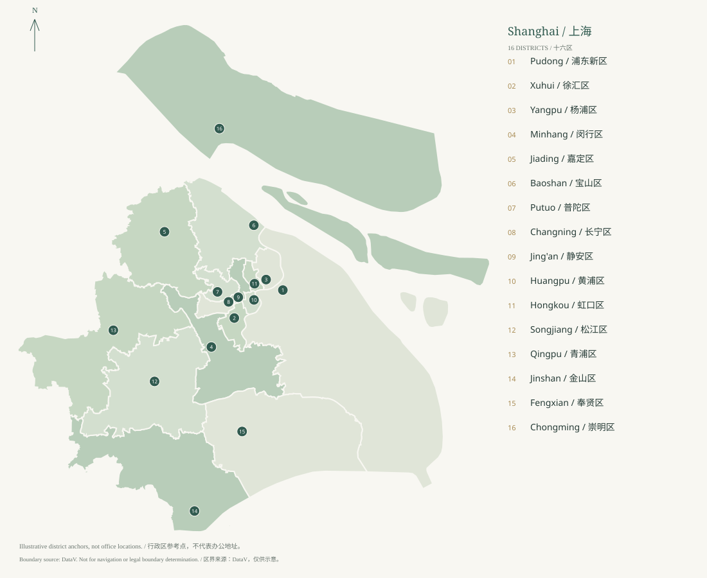

A city of connected possibilities
=================================

Shanghai becomes easier to navigate when we follow a project from research to prototype, from prototype to a first customer, and from that customer to a repeatable business. The useful unit is a working relationship: a laboratory, a district service team, an incubation operator, a buyer or an investment manager.

   Sixteen districts, connected by people, research and industry.

A practical atlas, with a stated boundary
-----------------------------------------

This edition covers all 16 administrative districts and the Ministry of Education's June 2026 Shanghai register of 69 ordinary higher-education institutions, including 40 undergraduate institutions and 29 diploma colleges. A separate appendix includes the 12 adult higher-education institutions. CEIBS and military institutions need separate treatment and are not silently added to the ordinary-university count.

The program directory is a researched selection, not a claim that every organization or funding call in Shanghai has been found. District policies, university entry routes, technology parks, public platforms, private operators and corporate initiatives change independently. Unknown details remain visible.

Our research date is 4 November 2026. A policy still within its stated validity period is not necessarily accepting applications. A launch announcement proves that an initiative was announced; it does not prove that a new cohort is open.

Three geographies, many choices
-------------------------------

The central city offers proximity to research, professional services and customers. Xuhui and Yangpu are useful starting points for model and university connections. Pudong combines Zhangjiang research, chip and biomedical activity with a distinct Lin-gang development area. These are starting hypotheses; the right operator and customer matter more than an address.

Minhang and Jiading help connect engineering research to industrial work. Baoshan, Songjiang, Jinshan and Fengxian offer different manufacturing contexts. Qingpu links regional collaboration and the Xicen research environment. Chongming is a distinct setting for ecological, agricultural and marine questions. The district chapters explain the evidence behind each route.

Functional areas are not extra districts. Zhangjiang, Caohejing, Hongqiao, G60 and Lin-gang can cross administrative or operating boundaries. We confirm registered address, actual operations, project location and the receiving authority before assuming a policy applies.

The magnolia and the pearl
--------------------------

Shanghai's official flower is the white magnolia, designated in 1986. Pearl white is the principal color of this atlas. Ink charcoal, mist jade and champagne gold form an editorial palette rather than an official municipal color standard. The cover is an original generated Chinese ink-style illustration, not a documentary photograph or a geographically exact skyline.

`Evidence S097 <https://english.shanghai.gov.cn/en-Overview/>`_. Shanghai municipal flower and overview.
